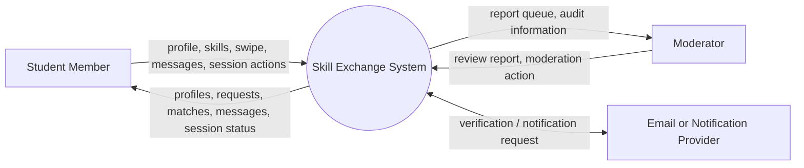
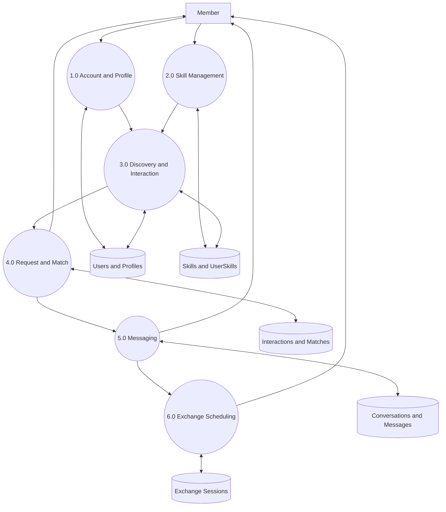
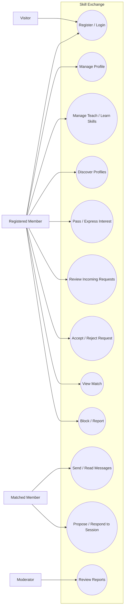
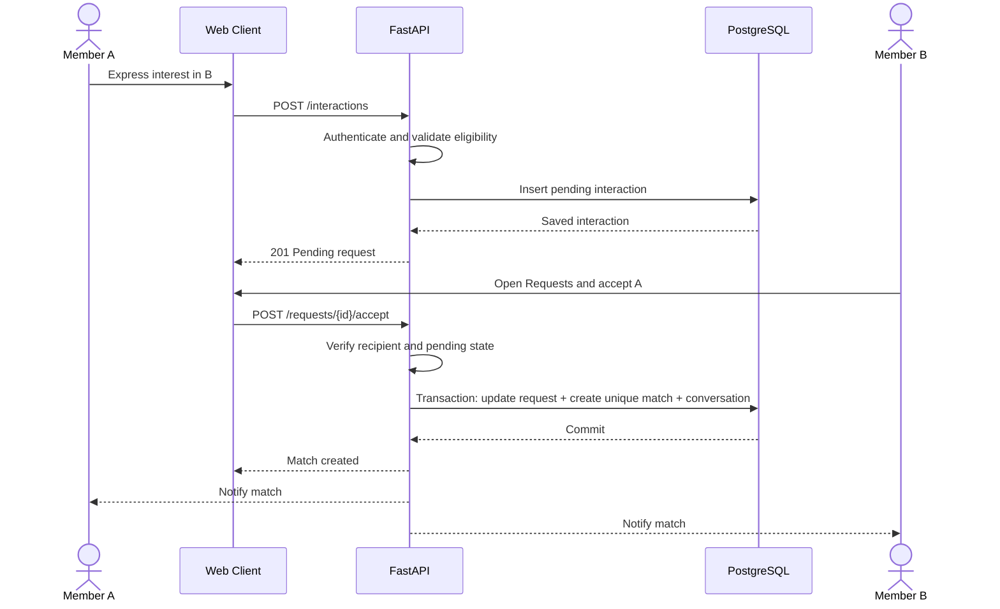
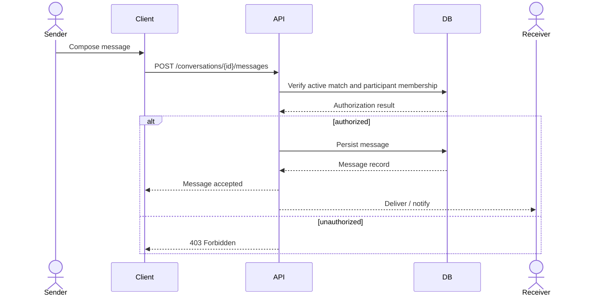
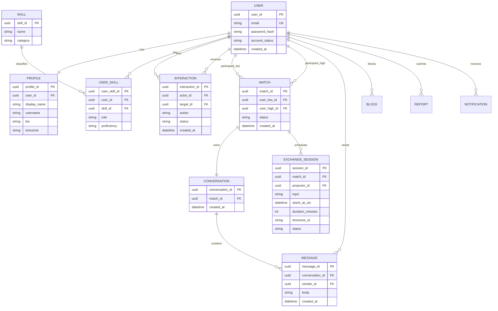
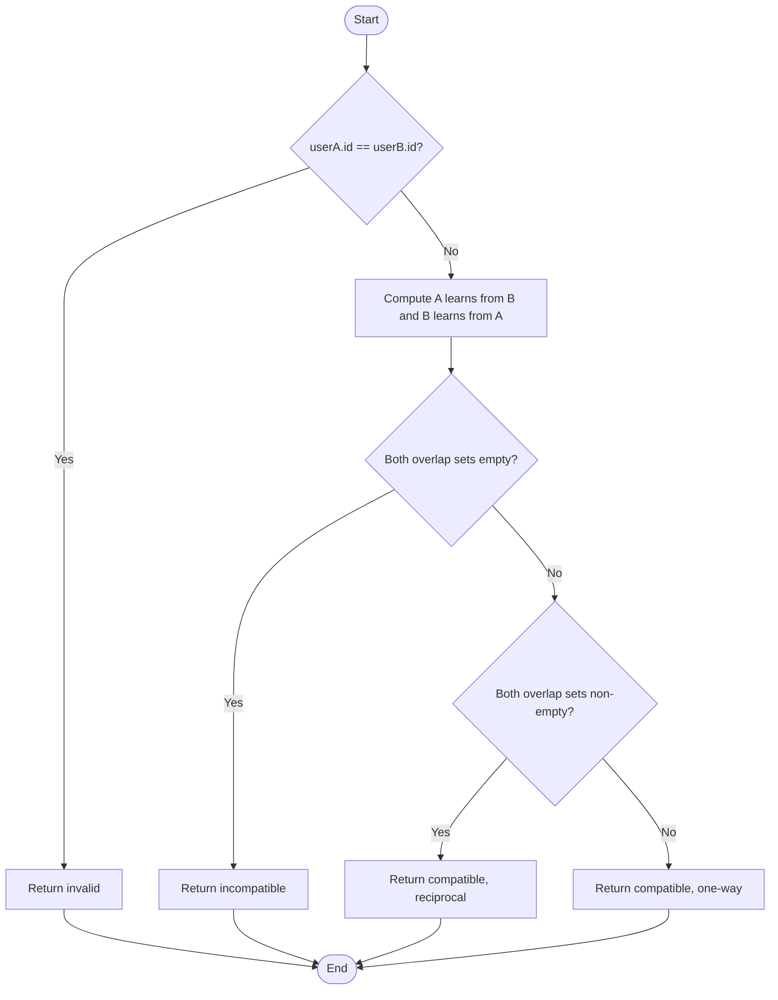

# Skill Exchange — Diagrams and Testing Artifacts

These Mermaid diagrams can be rendered in GitHub Markdown or imported into compatible Mermaid editors. They represent the **proposed target MVP**, not the current HTML prototype.

## 1. Context DFD (Level 0)

## 2. DFD Level 1

## 3. Use-case diagram

## 4. Sequence diagram — interest and acceptance

## 5. Sequence diagram — send message

## 6. ER diagram (conceptual)

## 7. Control-flow graph — compatibility module

Decision nodes = 3, so cyclomatic complexity **V(G) = D + 1 = 4**.

## 8. Basis paths and test cases

| Test ID | Path | Input | Expected result |
|---|---|---|---|
| TC-COMP-01 | Same user | A compared with A | Invalid; no compatibility |
| TC-COMP-02 | No overlap | A teaches Python/wants UI; B teaches Guitar/wants Excel | Incompatible |
| TC-COMP-03 | One-way overlap | A wants Python; B teaches Python; no reverse overlap | Compatible, reciprocal=false |
| TC-COMP-04 | Reciprocal overlap | A teaches UI/wants Python; B teaches Python/wants UI | Compatible, reciprocal=true |
| TC-COMP-05 | Case/whitespace normalization | " Python " vs "python" | Match after normalization |
| TC-COMP-06 | Empty skill sets | Both sets empty | Incompatible |

TC-COMP-05 and 06 are robustness tests beyond the four independent basis paths.

## 9. Additional system-level test scenarios

| ID | Scenario | Expected result |
|---|---|---|
| TC-MATCH-01 | A expresses interest in B | Pending request for B; no match yet |
| TC-MATCH-02 | B accepts A's pending request | Exactly one active match |
| TC-MATCH-03 | B rejects A's pending request | No match |
| TC-MATCH-04 | Duplicate acceptance request | No duplicate match; current state returned |
| TC-MATCH-05 | Member tries to swipe self | Rejected |
| TC-CHAT-01 | Non-participant accesses conversation ID | 403/404; no message data leaked |
| TC-CHAT-02 | Match participant sends message | Message persisted and visible to both |
| TC-SAFE-01 | A blocks B | New messages and discovery between pair denied |
| TC-SESSION-01 | Session uses different participant timezones | Same instant displayed in each local timezone |
| TC-SESSION-02 | Invalid or past session date | Validation error; no session created |

## 10. Prototype-to-target workflow gap

Current prototype: right swipe immediately opens a simulated match screen and creates a sample chat.  
Target requirement: right swipe creates a pending incoming request; recipient accepts; only then is a match and conversation created.  
Implementation task: update client state transitions and enforce them transactionally in the API/database.
